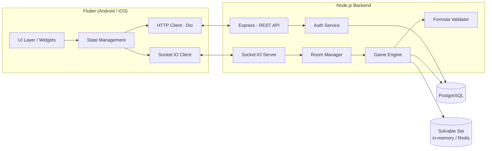

# Architecture — 24Card

**Versi:** 1.0 (Draft)
**Relasi:** [PRD](PRD.md) · [System Design](SystemDesign.md)

---

## 1. Diagram Arsitektur



**Prinsip inti:** klien adalah "thin client" — hanya merender dan mengirim niat. Seluruh logika game (penarikan kartu, challenge, validasi, penentuan pemenang) berjalan di server.

## 2. Struktur Repo (Monorepo)

```
24Card/
├── client/                      # Flutter
│   ├── lib/
│   │   ├── main.dart
│   │   ├── app/                 # routing, theme, DI
│   │   ├── core/                # constants, utils, socket service
│   │   ├── features/
│   │   │   ├── auth/            # guest login, register
│   │   │   ├── lobby/           # home, friend list
│   │   │   ├── room/            # create/join room, invite
│   │   │   ├── game/            # board ronde, raise, challenge, prove
│   │   │   └── leaderboard/
│   │   └── shared/              # widgets reuse
│   └── pubspec.yaml
│
├── server/                      # Node.js
│   ├── src/
│   │   ├── index.ts             # bootstrap express + socket.io
│   │   ├── config/              # env, db, constants
│   │   ├── api/                 # REST routes (auth, profile, leaderboard)
│   │   ├── socket/              # socket handlers per event
│   │   ├── game/
│   │   │   ├── engine.ts        # state machine ronde
│   │   │   ├── deck.ts          # 40 kartu, penarikan
│   │   │   ├── solver.ts        # brute-force solvable set
│   │   │   └── validator.ts     # validasi ekspresi anti-cheat
│   │   ├── room/roomManager.ts
│   │   ├── auth/                # JWT, bcrypt, guest flow
│   │   ├── db/                  # prisma / pg client, migrations
│   │   └── ws/                  # socket.io setup, adapter
│   ├── prisma/schema.prisma
│   └── package.json
│
├── docs/                        # PRD.md, SystemDesign.md, Architecture.md
├── docker-compose.yml           # postgres + server
└── README.md
```

## 3. Stack Teknologi

### 3.1 Client — Flutter
| Komponen | Pilihan | Alasan |
|---|---|---|
| Bahasa | Dart 3 | Native Flutter |
| State management | **Riverpod** | Testable, tanpa boilerplate berlebih |
| Navigasi | go_router | Standard Flutter |
| HTTP | dio | Interceptor JWT, retry |
| Realtime | socket_io_client | Pasangan Socket.IO server |
| Model | freezed + json_serializable | Immutable state, JSON aman |

Target: Android 8+, iOS 13+.

### 3.2 Server — Node.js
| Komponen | Pilihan | Alasan |
|---|---|---|
| Runtime | Node 20 LTS | LTS stabil |
| Bahasa | TypeScript | Safety tipe di game logic |
| HTTP | Express 4 | REST auth/leaderboard |
| Realtime | **socket.io 4** | Auto-reconnect, room namespace, adapter Redis |
| DB ORM | Prisma | Migrasi & type-safe query |
| DB | PostgreSQL 16 | Relational, JSONB untuk payload ronde |
| Auth | jsonwebtoken + bcrypt | JWT + hash password |
| Validasi | parser ekspresi custom (tokenisasi → AST) | Anti-cheat, tanpa eval mentah |
| Testing | vitest | Unit test solver & validator |

## 4. Client Architecture (Flutter)

**Pola:** feature-first + Riverpod (state per fitur).

```
features/game/
├── data/           # socket event models, repository
├── domain/         # entities (Card24, RoundState), usecases
├── presentation/   # widgets: board, raise button, challenge dialog, prove input
└── providers/      # Riverpod providers
```

**Alur data klien:**
1. `SocketService` menerima event server → update `GameStateNotifier`
2. Widget rebuild dari state (immutable)
3. Aksi pemain (raise/challenge/prove) → emit event ke server → server balas dengan state resmi

Klien **tidak** menghitung pemenang ronde — hanya menampilkan hasil `round:proof_result` & `round:resolved` dari server.

## 5. Server Architecture (Node.js)

**Lapisan:**
- `api/` — REST: `/auth/*`, `/profile`, `/leaderboard`
- `socket/` — handler per event (`room:create`, `round:raise`, …) → delegasi ke service
- `room/` — lifecycle room: kode unik 6 karakter, kapasitas 2–10, host
- `game/` — state machine ronde + solver + validator

**Game Engine** memegang state room in-memory (cepat, tidak hit DB per ronde) dan menulis ke DB hanya saat ronde selesai & game selesai.

**Validator (anti-cheat)** — pipeline:
1. Tokenisasi string (whitelist: digit 1–10, `+ - * /`, kurung)
2. Parse ke AST sendiri (tanpa eval)
3. Evaluasi → cek `== 24`
4. Cek multiset kartu (As = 1 atau 11 diterima)
5. Cek setiap pembagian bulat

## 6. Database Schema (PostgreSQL)

```sql
CREATE TABLE users (
  id            UUID PRIMARY KEY DEFAULT gen_random_uuid(),
  username      VARCHAR(24) UNIQUE NOT NULL,
  password_hash TEXT,                      -- NULL untuk guest
  is_guest      BOOLEAN NOT NULL DEFAULT true,
  created_at    TIMESTAMPTZ NOT NULL DEFAULT now(),
  games_played  INT NOT NULL DEFAULT 0,
  wins          INT NOT NULL DEFAULT 0,
  win_rate      NUMERIC(5,2) NOT NULL DEFAULT 0
);

CREATE TABLE friends (
  user_id   UUID REFERENCES users(id) ON DELETE CASCADE,
  friend_id UUID REFERENCES users(id) ON DELETE CASCADE,
  status    VARCHAR(16) NOT NULL,          -- pending | accepted
  PRIMARY KEY (user_id, friend_id)
);

CREATE TABLE games (
  id         UUID PRIMARY KEY DEFAULT gen_random_uuid(),
  room_code  VARCHAR(6) NOT NULL,
  started_at TIMESTAMPTZ NOT NULL DEFAULT now(),
  ended_at   TIMESTAMPTZ,
  winner_id  UUID REFERENCES users(id),
  status     VARCHAR(16) NOT NULL          -- in_progress | finished | aborted
);

CREATE TABLE game_players (
  game_id          UUID REFERENCES games(id) ON DELETE CASCADE,
  user_id          UUID REFERENCES users(id),
  seat             INT NOT NULL,
  final_card_count INT,
  placement        INT,                    -- NULL jika tie (kalah)
  PRIMARY KEY (game_id, user_id)
);

CREATE TABLE rounds (
  id               UUID PRIMARY KEY DEFAULT gen_random_uuid(),
  game_id          UUID REFERENCES games(id) ON DELETE CASCADE,
  round_no         INT NOT NULL,
  cards            JSONB NOT NULL,         -- [{suit, value, asChoice}]
  raised_players   JSONB NOT NULL,
  challenger_id    UUID,
  target_id        UUID,
  proof_expression TEXT,
  proof_valid      BOOLEAN,
  penalty_user_id  UUID REFERENCES users(id)
);

CREATE INDEX idx_users_winrate ON users (win_rate DESC);
CREATE INDEX idx_games_status  ON games (status);
```

## 7. Kontrak API (ringkas)

### REST
| Method | Path | Fungsi |
|---|---|---|
| POST | `/auth/guest` | Buat sesi guest → JWT |
| POST | `/auth/register` | Daftar (username, password) |
| POST | `/auth/upgrade` | Guest → akun penuh |
| GET | `/profile` | Profil + statistik |
| GET | `/leaderboard?limit=50` | Peringkat win rate |
| POST | `/friends/invite` | Undang teman |

### Socket (namespace `/game`)
Lihat [SystemDesign §4](SystemDesign.md) untuk katalog event lengkap.

## 8. Deployment

**Docker Compose (dev):**
```yaml
services:
  postgres:
    image: postgres:16
    environment: [POSTGRES_DB=twentycard]
    volumes: [pgdata:/var/lib/postgresql/data]
  server:
    build: ./server
    depends_on: [postgres]
    ports: ["3000:3000"]
```

**Produksi:**
- Server di VPS/cloud (Fly.io / Railway / VPS sendiri) — Docker image
- Postgres managed (Neon / Supabase) atau self-host
- Socket.IO **Redis adapter** bila scale >1 proses (sticky session via load balancer)
- HTTPS + WSS di depan nginx/caddy
- Precompute solvable set disimpan sebagai artifact agar boot cepat

## 9. Keputusan Terbuka

1. Mekanisme escape deadlock ronde (PRD §7) — mis. host restart setelah idle
2. Anti-stalling raise tanpa batas waktu
3. Skema upgrade guest → registered saat ada data duplikat
4. Ranked/ELO (v2)
